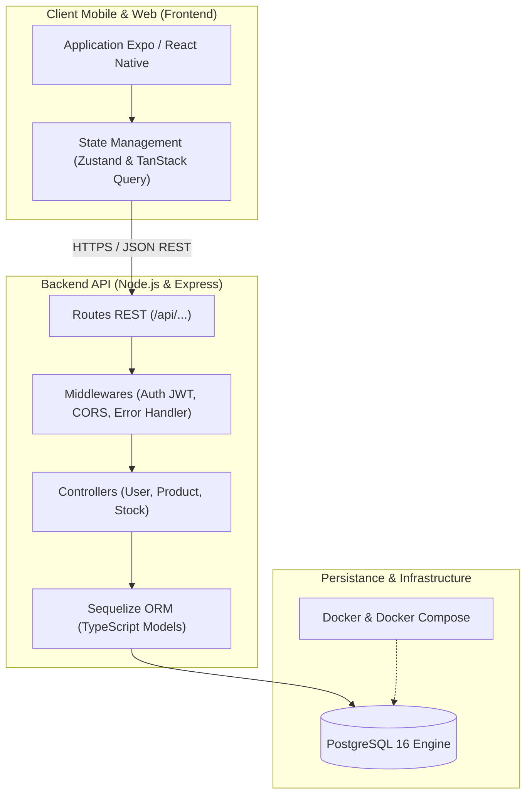
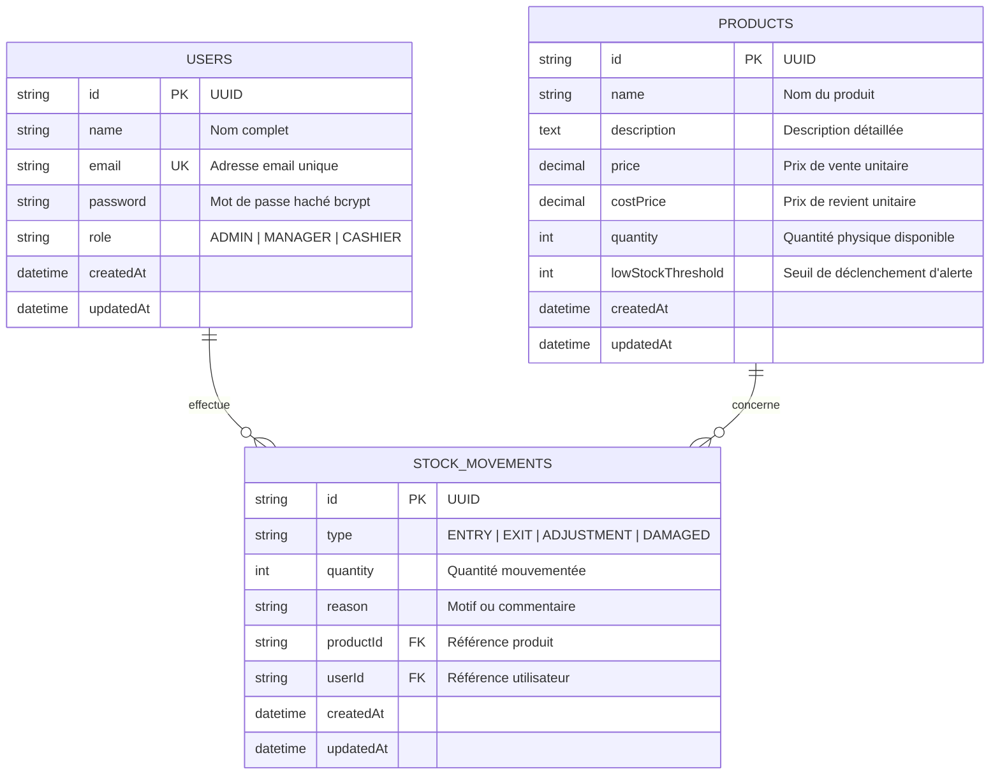
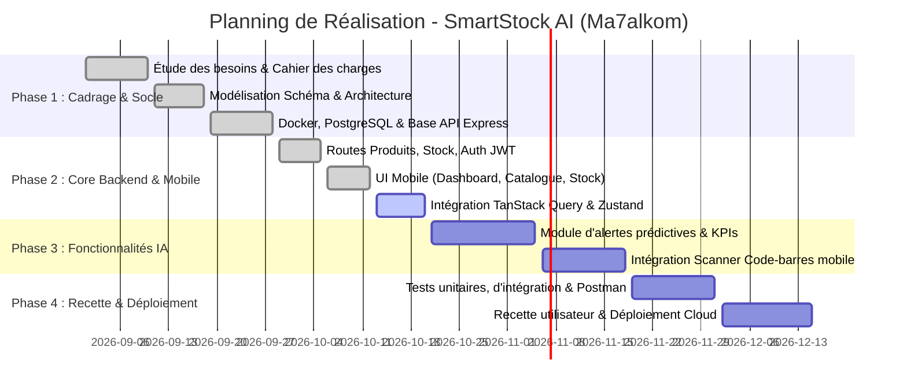

# 📋 Cahier des Charges Fonctionnel et Technique (CdCFT)
## Projet : SmartStock AI (Ma7alkom - محالكم)
### Solution Intelligente de Gestion de Stock & de Commerce de Proximité

---

| **Information** | **Détail** |
| :--- | :--- |
| **Projet** | SmartStock AI (Ma7alkom) |
| **Type de projet** | Projet de Fin d'Études (PFE) / Solution SaaS Métier |
| **Version du document** | 1.0.0 |
| **Statut** | Validé & En cours de déploiement |
| **Cible** | Commerces de détail, épiceries, supérettes, boutiques, grossistes |
| **Plateformes** | Mobile (Android & iOS via Expo) + API Backend (Node.js/Express) |
| **Base de Données** | PostgreSQL 16 (Dockerisé) |

---

## 📑 Sommaire

1. [Présentation Générale & Contexte](#1-présentation-générale--contexte)
2. [Objectifs du Projet](#2-objectifs-du-projet)
3. [Périmètre du Projet (Scope)](#3-périmètre-du-projet-scope)
4. [Acteurs, Rôles & Matrice des Droits (RBAC)](#4-acteurs-rôles--matrice-des-droits-rbac)
5. [Spécifications Fonctionnelles Détaillées](#5-spécifications-fonctionnelles-détaillées)
   - 5.1 [Module Authentification & Sécurité](#51-module-authentification--sécurité)
   - 5.2 [Module Catalogue Produits & Prix](#52-module-catalogue-produits--prix)
   - 5.3 [Module Mouvements de Stock & Traçabilité](#53-module-mouvements-de-stock--traçabilité)
   - 5.4 [Module Tableau de Bord & Indicateurs (KPIs)](#54-module-tableau-de-bord--indicateurs-kpis)
   - 5.5 [Module Intelligent SmartStock AI](#55-module-intelligent-smartstock-ai)
6. [Spécifications Non-Fonctionnelles](#6-spécifications-non-fonctionnelles)
7. [Architecture Technique & Stack Technologique](#7-architecture-technique--stack-technologique)
8. [Modèle de Données & Schéma Relationnel](#8-modèle-de-données--schéma-relationnel)
9. [Spécifications des Interfaces & API REST](#9-spécifications-des-interfaces--api-rest)
10. [Planning Prévisionnel & Jalons de Réalisation](#10-planning-prévisionnel--jalons-de-réalisation)
11. [Critères d'Acceptation & Modalités de Recette](#11-critères-dacceptation--modalités-de-recette)

---

## 1. Présentation Générale & Contexte

### 1.1 Contexte Métier
Dans le secteur du commerce de détail et des points de vente de proximité (ex: épiceries de quartier, supérettes, boutiques au Maroc et en Afrique du Nord), la gestion des stocks reste très majoritairement artisanale, reposant sur des carnets manuscrits ou la mémoire des gérants.

Cette gestion manuelle engendre des dysfonctionnements critiques :
- **Ruptures de stock imprévues** sur les produits à forte rotation (perte sèche de chiffre d'affaires et insatisfaction client).
- **Sur-stockage ou produits périmés/avariés** entraînant une dépréciation financière importante et des marges réduites.
- **Absence de visibilité en temps réel** sur la valorisation du stock, la rentabilité par produit et les marges bénéficiaires.
- **Manque de traçabilité** : difficultés à identifier l'origine des écarts d'inventaire, vols ou pertes.

### 1.2 La Solution : SmartStock AI (Ma7alkom)
**SmartStock AI (Ma7alkom - محالكم)** est une solution mobile-first conçue pour démocratiser la gestion de stock moderne et intelligente :
- Une application mobile ultra-réactive, accessible et ergonomique permettant aux commerçants et employés de saisir et consulter les données directement sur le terrain.
- Un backend robuste et scalable sous TypeScript/Node.js assurant l'intégrité transactionnelle.
- Une couche d'assistance intelligente (IA) pour l'aide à la décision, les alertes prédictives de réapprovisionnement et l'optimisation des flux.

---

## 2. Objectifs du Projet

### 2.1 Objectifs Généraux
1. **Digitaliser intégralement les flux de marchandises** (entrées, sorties, ajustements, pertes).
2. **Fournir une visibilité instantanée** de l'état des stocks et des indicateurs de performance financiers (marges, valeur du stock).
3. **Réduire drastiquement le taux de rupture de stock** grâce à un système d'alertes automatiques et de seuils configurables.
4. **Simplifier la prise en main** grâce à une interface intuitive nécessitant zéro formation technique préalable.

### 2.2 Indicateurs Clés de Succès (KPIs Métier)
- **Taux de rupture de stock :** Réduction estimée de plus de 40% dès le premier mois d'utilisation.
- **Temps consacré à l'inventaire :** Réduction de 60% par rapport à l'inventaire manuel sur papier.
- **Fiabilité des stocks :** Taux de concordance stock théorique / stock physique > 98%.
- **Temps de saisie moyen :** Moins de 10 secondes pour enregistrer un mouvement de stock depuis le mobile.

---

## 3. Périmètre du Projet (Scope)

### 3.1 Périmètre Inclus (In-Scope)
- **Application Mobile Cross-Platform** (Android / iOS / Web preview) construite avec Expo et React Native.
- **Backend API RESTful** sous Node.js (Express, TypeScript, Sequelize).
- **Base de données relationnelle PostgreSQL** hautement performante et isolée via Docker Compose.
- **Gestion des rôles et contrôle d'accès** (`ADMIN`, `MANAGER`, `CASHIER`).
- **Gestion complète du catalogue produits** (prix d'achat, prix de vente, marge, quantité, seuil d'alerte).
- **Gestion des mouvements de stock multi-types** (`ENTRY`, `EXIT`, `ADJUSTMENT`, `DAMAGED`) avec motif et horodatage.
- **Tableau de bord dynamique** avec calcul instantané des indicateurs (produits critiques, stock total, valeur).
- **Historique et traçabilité complète des opérations** (audit trail par utilisateur et produit).

### 3.2 Périmètre Futur / Évolutions (Out-of-Scope Phase 1)
- Module de caisse enregistreuse (POS / Point of Sale) complet avec imprimante thermique de tickets.
- Passerelle de paiement en ligne pour commande e-commerce B2B.
- Gestion multi-entrepôts géographiquement dispersés (prévu en Phase 4).

---

## 4. Acteurs, Rôles & Matrice des Droits (RBAC)

Le système implémente un contrôle d'accès strict basé sur les rôles (Role-Based Access Control) :

| Fonctionnalité | `ADMIN` (Propriétaire / Directeur) | `MANAGER` (Responsable de Stock) | `CASHIER` (Vendeur / Caissier) |
| :--- | :---: | :---: | :---: |
| **Connexion / Authentification** | ✅ | ✅ | ✅ |
| **Consulter le Dashboard & KPIs** | ✅ (Vue globale + financière) | ✅ (Vue opérationnelle) | ⚠️ (KPIs restreints) |
| **Créer / Modifier un Utilisateur** | ✅ | ❌ | ❌ |
| **Consulter le Catalogue Produits** | ✅ | ✅ | ✅ |
| **Créer / Modifier un Produit** | ✅ | ✅ | ❌ |
| **Supprimer un Produit** | ✅ | ❌ | ❌ |
| **Voir les Prix d'Achat & Marges** | ✅ | ✅ | ❌ (Prix de vente seul) |
| **Enregistrer une Sortie (`EXIT`)** | ✅ | ✅ | ✅ |
| **Enregistrer une Entrée (`ENTRY`)** | ✅ | ✅ | ❌ |
| **Ajuster le stock (`ADJUSTMENT`)** | ✅ | ✅ | ❌ |
| **Déclarer des Pertes (`DAMAGED`)** | ✅ | ✅ | ⚠️ (Soumis à validation) |
| **Consulter l'Audit des Mouvements**| ✅ (Historique complet) | ✅ (Historique magasin) | ❌ |

---

## 5. Spécifications Fonctionnelles Détaillées

### 5.1 Module Authentification & Sécurité
- **SF-01.1 : Connexion Utilisateur**
  - Authentification par adresse e-mail et mot de passe chiffré.
  - Génération d'un token sécurisé JWT (*JSON Web Token*) d'une validité de 7 jours.
  - Persistance sécurisée de la session sur mobile.
- **SF-01.2 : Déconnexion**
  - Révocation locale du jeton et réinitialisation de l'état applicatif.
- **SF-01.3 : Gestion des Profils**
  - Création de comptes par l'administrateur avec attribution du rôle adéquat.
  - Mots de passe chiffrés à sens unique via `bcrypt` (facteur de coût >= 10).

### 5.2 Module Catalogue Produits & Prix
- **SF-02.1 : Consultation du Catalogue**
  - Liste paginée / défilable des produits avec tri alphabétique et indicateur de stock.
  - Filtres rapides :
    - *Tous les produits* (`ALL`)
    - *Stock faible* (`LOW` : quantité <= seuil d'alerte)
    - *Rupture de stock* (`OUT` : quantité = 0)
  - Recherche plein texte instantanée par nom ou référence.
- **SF-02.2 : Fiche Détaillée Produit**
  - Affichage complet : nom, description, prix de vente public, prix de revient / achat, stock disponible, valeur totale en stock, seuil critique.
  - Badge d'état dynamique (*En stock*, *Stock Faible*, *Rupture de Stock*).
- **SF-02.3 : Création & Édition de Produit**
  - Formulaire modal avec validation stricte des champs :
    - Nom du produit (obligatoire)
    - Prix de vente (numérique positif obligatoire)
    - Prix de revient / achat (numérique positif obligatoire)
    - Quantité initiale (entier >= 0)
    - Seuil de stock faible (entier personnalisable, défaut : 5)
    - Description libre (optionnelle)
- **SF-02.4 : Suppression de Produit**
  - Réservée au rôle `ADMIN`, avec confirmation préalable et gestion de l'intégrité référentielle.

### 5.3 Module Mouvements de Stock & Traçabilité
- **SF-03.1 : Types de Mouvements Pris en Charge**
  1. `ENTRY` (Entrée) : Réception de commande fournisseur, livraison, retour client. Incrémente le stock.
  2. `EXIT` (Sortie) : Vente au comptoir, sortie directe, transfert. Décrémente le stock avec contrôle d'insuffisance.
  3. `ADJUSTMENT` (Ajustement) : Alignement manuel lors d'un inventaire physique (redéfinit la quantité exacte).
  4. `DAMAGED` (Pertes / Avaries) : Produits périmés, cassés, détériorés. Décrémente le stock et trace la perte.
- **SF-03.2 : Intégrité Transactionnelle**
  - Contrôle strict anti-stock négatif : rejet automatique de toute sortie (`EXIT`, `DAMAGED`) si le stock actuel est inférieur à la quantité demandée.
  - Mise à jour atomique de la quantité du produit et insertion de la ligne d'audit.
- **SF-03.3 : Audit Trail (Journal d'Audit)**
  - Chaque mouvement consigne : le produit concerné, le type d'opération, la quantité mouvementée, le motif/justification, l'utilisateur responsable et l'horodatage précis.

### 5.4 Module Tableau de Bord & Indicateurs (KPIs)
- **SF-04.1 : Vue Synthétique en Temps Réel**
  - Total des références produits enregistrées.
  - Nombre de produits en situation de stock critique (faible ou épuisé).
  - Volume total d'unités physiques en magasin.
  - Flux des 5 derniers mouvements récents avec code couleur d'état.
- **SF-04.2 : Actions Rapides (Quick Actions)**
  - Boutons de raccourci : « Nouveau Produit », « Entrée de Stock », « Vente / Sortie », « Rafraîchir ».
- **SF-04.3 : Mode Hors-Ligne & Rechargement**
  - *Pull-to-refresh* natif permettant la synchronisation immédiate des indicateurs.

### 5.5 Module Intelligent SmartStock AI
- **SF-05.1 : Détection Automatique des Risques de Rupture**
  - Analyse dynamique de la vélocité des sorties pour alerter avant l'épuisement effectif.
- **SF-05.2 : Suggestions de Réapprovisionnement Intelligent**
  - Proposition de quantité optimale de commande basée sur les tendances historiques et les seuils minimaux.
- **SF-05.3 : Scan Mobile (Roadmap IA)**
  - Scan de code-barres / QR Code via caméra Expo Camera pour sélection instantanée du produit.
  - Reconnaissance automatique de texte (OCR) pour lecture de bons de livraison.

---

## 6. Spécifications Non-Fonctionnelles

| Domaine | Exigence | Métrique / Règle |
| :--- | :--- | :--- |
| **Performance** | Temps de réponse de l'API | < 150 ms pour 95% des requêtes en charge normale |
| **Fluidité Mobile** | Taux de rafraîchissement | 60 images par seconde (FPS constant), 0 freeze UI |
| **Disponibilité** | Disponibilité du service API | 99.5% de disponibilité mensuelle |
| **Sécurité** | Chiffrement & Authentification | Mots de passe hachés via `bcrypt` (10 rounds), Tokens JWT signés, HTTPS |
| **Conformité & Intégrité** | Propriétés ACID | Transactions relationnelles strictes PostgreSQL, pas d'incohérences de stock |
| **Compatibilité** | Systèmes d'exploitation | Android 10+, iOS 15+, navigateurs modernes (Chrome/Safari) |
| **Ergonomie** | Design System épuré | Palette HSL moderne, contrastes WCAG AA, interface bilingue/Français intuitif |

---

## 7. Architecture Technique & Stack Technologique

### 7.1 Vue d'Ensemble de l'Architecture
Le système repose sur une architecture **3-Tiers découplée et orientée services REST** :



### 7.2 Stack Technologique Détaillée

#### Frontend Mobile
- **Framework :** React Native 0.86 avec Expo SDK 57 (Architecture moderne)
- **Routage :** Expo Router (File-based navigation avec TypeScript strict)
- **Gestion d'état serveur :** TanStack React Query v5 (mise en cache, invalidation automatique, refetch en arrière-plan)
- **Gestion d'état client :** Zustand v5 (session utilisateur, préférences)
- **Design System & UI :** Styles modulaires personnalisés (Tokens unifiés `theme.ts`, aucun framework lourd tiers)

#### Backend API
- **Runtime :** Node.js >= 20.0 LTS
- **Framework Web :** Express 4.21 avec typage TypeScript 5.7
- **Exécution & Build :** `tsx` (mode dev avec rechargement à chaud) & `tsc` (compilation de production)
- **ORM / Accès Données :** Sequelize 6 avec pilote natif `pg`
- **Sécurité :** JSON Web Tokens (`jsonwebtoken`), hachage fort `bcryptjs`, CORS middleware

#### Base de Données & Infrastructure
- **SGBD :** PostgreSQL 16 (images officielles Alpine Linux)
- **Conteneurisation :** Docker & Docker Compose
- **Environnements :** Variables d'environnement configurées via `.env` avec validation

---

## 8. Modèle de Données & Schéma Relationnel

### 8.1 Diagramme Entité-Relation (ERD)



### 8.2 Dictionnaire des Données

#### Table `users`
| Champ | Type SQL | Nullable | Contraintes | Description |
| :--- | :--- | :---: | :--- | :--- |
| `id` | VARCHAR(255) | Non | Clé Primaire (UUID) | Identifiant unique de l'utilisateur |
| `name` | VARCHAR(255) | Non | - | Nom complet ou dénomination |
| `email` | VARCHAR(255) | Non | Unique, Indexé | Email de connexion |
| `password` | VARCHAR(255) | Non | - | Empreinte chiffrée du mot de passe |
| `role` | ENUM | Non | Défaut: `'MANAGER'` | `'ADMIN'`, `'MANAGER'`, ou `'CASHIER'` |
| `createdAt` | TIMESTAMP | Non | `CURRENT_TIMESTAMP` | Date de création |
| `updatedAt` | TIMESTAMP | Non | `CURRENT_TIMESTAMP` | Date de dernière mise à jour |

#### Table `products`
| Champ | Type SQL | Nullable | Contraintes | Description |
| :--- | :--- | :---: | :--- | :--- |
| `id` | VARCHAR(255) | Non | Clé Primaire (UUID) | Identifiant unique du produit |
| `name` | VARCHAR(255) | Non | - | Nom commercial du produit |
| `description` | TEXT | Oui | - | Détails complémentaires |
| `price` | DECIMAL(10,2) | Non | >= 0 | Prix de vente public |
| `costPrice` | DECIMAL(10,2) | Non | >= 0 | Prix de revient / achat |
| `quantity` | INTEGER | Non | Défaut: 0, >= 0 | Stock physique en réserve |
| `lowStockThreshold`| INTEGER | Non | Défaut: 5, >= 0 | Seuil déclenchant l'alerte stock |
| `createdAt` | TIMESTAMP | Non | `CURRENT_TIMESTAMP` | Date de création |
| `updatedAt` | TIMESTAMP | Non | `CURRENT_TIMESTAMP` | Date de modification |

#### Table `stock_movements`
| Champ | Type SQL | Nullable | Contraintes | Description |
| :--- | :--- | :---: | :--- | :--- |
| `id` | VARCHAR(255) | Non | Clé Primaire (UUID) | Identifiant unique du mouvement |
| `type` | ENUM | Non | - | `'ENTRY'`, `'EXIT'`, `'ADJUSTMENT'`, `'DAMAGED'` |
| `quantity` | INTEGER | Non | > 0 | Quantité concernée |
| `reason` | VARCHAR(255) | Oui | - | Motif ou commentaire justificatif |
| `productId` | VARCHAR(255) | Non | Clé Étrangère (`products.id`) | Référence du produit |
| `userId` | VARCHAR(255) | Oui | Clé Étrangère (`users.id`) | Auteur de l'action |
| `createdAt` | TIMESTAMP | Non | `CURRENT_TIMESTAMP` | Date et heure de l'opération |
| `updatedAt` | TIMESTAMP | Non | `CURRENT_TIMESTAMP` | Date de mise à jour |

---

## 9. Spécifications des Interfaces & API REST

Tous les échanges s'effectuent au format **JSON** via protocole standard HTTP/HTTPS.

### 9.1 Matrice des Endpoints API

| Méthode | Route | Rôle Requis | Description | Codes HTTP |
| :--- | :--- | :--- | :--- | :--- |
| `GET` | `/api/health` | Public | Vérification de la disponibilité du serveur | 200, 503 |
| `POST` | `/api/users/login` | Public | Authentification et émission du token JWT | 200, 400, 401 |
| `GET` | `/api/users` | Admin | Liste de tous les utilisateurs | 200, 401, 403 |
| `GET` | `/api/users/:id` | Authentifié | Détails d'un utilisateur par identifiant | 200, 404 |
| `POST` | `/api/users` | Admin | Création d'un nouvel utilisateur | 201, 400, 409 |
| `GET` | `/api/products` | Authentifié | Liste ordonnée de tous les produits | 200 |
| `GET` | `/api/products/:id` | Authentifié | Consultation d'un produit par ID | 200, 404 |
| `POST` | `/api/products` | Manager/Admin | Création d'un nouveau produit | 201, 400 |
| `PUT` | `/api/products/:id` | Manager/Admin | Mise à jour des informations produit | 200, 400, 404 |
| `DELETE`| `/api/products/:id` | Admin | Suppression d'un produit | 200, 404 |
| `GET` | `/api/stock` | Authentifié | Liste chronologique des mouvements de stock | 200 |
| `POST` | `/api/stock` | Authentifié | Enregistrement d'un mouvement (`ENTRY`, `EXIT`, etc.) | 201, 400, 404 |

### 9.2 Format Standard des Réponses

#### Succès (Code 200 / 201)
```json
{
  "success": true,
  "data": { ... }
}
```

#### Erreur (Code 400 / 401 / 404 / 500)
```json
{
  "success": false,
  "error": "Description explicite du motif de l'erreur"
}
```

---

## 10. Planning Prévisionnel & Jalons de Réalisation



---

## 11. Critères d'Acceptation & Modalités de Recette

### 11.1 Critères d'Acceptation Fonctionnels
- [x] L'application permet à un gérant de se connecter et d'accéder directement au Dashboard avec ses statistiques calculées en temps réel.
- [x] Tout produit créé apparaît instantanément dans la liste des produits avec possibilité de recherche et de filtrage dynamique.
- [x] L'enregistrement d'une sortie (`EXIT`) supérieure à la quantité disponible est formellement bloqué avec un message d'erreur clair.
- [x] Tout mouvement de stock modifie immédiatement la quantité en stock du produit et enregistre une ligne d'historique inaltérable.
- [x] Le statut d'alerte (`Stock Faible` ou `Rupture de Stock`) est calculé dynamiquement et affiché sans délai de rafraîchissement.

### 11.2 Critères d'Acceptation Techniques
- [x] Couverture de test via la collection de requêtes Postman automatisée (`SmartStock_AI_Backend.postman_collection.json`).
- [x] Compilation TypeScript sans erreur (`npm run typecheck` dans le backend et `npx tsc --noEmit` sur mobile).
- [x] Déploiement reproductible de la base de données via `docker-compose up -d`.
- [x] Respect des standards de code et conventions de nommage définis dans `AGENTS.md`.

---

> **SmartStock AI (Ma7alkom)** — Document de référence pour l'équipe de développement, la maîtrise d'ouvrage et le jury d'évaluation.
